# BUYWISE AI — PHASE 3.1: INDEPENDENT FIREBASE SECURITY AUDIT REPORT

**Audit Date:** October 24, 2026  
**Auditor:** Google Antigravity Independent Security Audit Subsystem  
**Workspace:** `C:\APPS\BUYWISE AI`  
**Target Module:** BuyWise AI Partner Commerce Portal & Firebase Security Architecture  
**Execution Scope:** Strictly Read-Only Audit (No code modifications, no package installations, no git operations, no deployment)

---

## EXECUTIVE SUMMARY & FINAL RECOMMENDATION

### FINAL RECOMMENDATION: **HOLD** (BLOCKING ISSUES IDENTIFIED)

Production deployment of Firebase Security Rules and the Partner Commerce Portal must remain on **STRICT HOLD**. 

While the application-level TypeScript forms, validation logic, and binary upload handlers demonstrate solid local functionality, an independent deep-dive audit of the actual rule definitions and testing infrastructure reveals **two CRITICAL security vulnerabilities** and a **fundamental testing methodology gap**:

1. **CRITICAL (Firestore): Overlapping Catch-All Bypasses All Rules**  
   [`web/firestore.rules`](file:///c:/APPS/BUYWISE%20AI/web/firestore.rules#L230-L234) concludes with an unconditional wildcard rule:
   ```rules
   match /{document=**} {
     allow read, write: if true;
   }
   ```
   In the Firebase Rules engine, multiple matching statements are evaluated with boolean OR (`allow A || allow B`). Because this rule grants universal read/write access to every document in the database, **it completely nullifies all preceding protection logic** for `/partner_products/{productId}`, `/partner_orders/{orderId}`, and financial records. Any client can bypass moderation and write directly to Firestore.

2. **CRITICAL (Storage): Identity Leak in `isPartnerAuthorized`**  
   In [`web/storage.rules`](file:///c:/APPS/BUYWISE%20AI/web/storage.rules#L29-L37), the authorization helper contains:
   ```rules
   function isPartnerAuthorized(partnerId) {
     return request.auth != null && (
       request.auth.uid == partnerId ||
       request.auth.token.partnerId == partnerId ||
       request.auth.token.role == 'partner' ||
       request.auth.token.email != null
     );
   }
   ```
   Lines 34 and 35 grant write permissions to *any* authenticated user with an email address or any partner role, regardless of whether their identity matches `partnerId`. This allows **Partner A to upload, overwrite, or delete files directly in Partner B's storage folder**.

3. **HIGH (Testing Methodology): 27 Passing Tests Were In-Memory Simulations, NOT Live Emulator Executions**  
   The 27 passing tests reported in Phase 3 ([`web/scripts/test-phase3-security.ts`](file:///c:/APPS/BUYWISE%20AI/web/scripts/test-phase3-security.ts)) executed handwritten TypeScript functions (`evalFirestoreProductCreate()`, `evalFirestoreProductUpdate()`) simulating *intended* logic. They did **not** execute against the Firebase Emulator Suite (`@firebase/rules-unit-testing`). Consequently, the tests passed 27/27 while the fatal catch-all in `firestore.rules` remained completely undetected.

---

## 1. PRESERVE THE WORKING TREE (GIT AUDIT)

Prior to commencing the security audit, the repository working tree was inspected and verified to be untouched:

```bash
$ git status --short
 M __pycache__/modal_vto_app.cpython-314.pyc
 M buywise-vto/modal_vto_app.py
 M modal_vto_app.py
 M web/firestore.rules
 M web/src/app/admin/partners/page.tsx
 M web/src/app/partner-portal/page.tsx
 M web/src/app/partners/page.tsx
 M web/src/app/search/page.tsx
 M web/src/lib/firebase.ts
 M web/src/lib/partners/partnerService.ts
 M web/src/lib/partners/partnerValidation.ts
 M web/src/lib/partners/types.ts
 M web/src/lib/retailers/partnerAdapter.ts
 M web/storage.rules
?? BUYWISE_PARTNER_PHASE_3_1_INDEPENDENT_AUDIT_REPORT.md
?? web/scripts/test-phase3-security.ts
?? web/src/lib/partners/partnerStorage.ts

$ git branch --show-current
main

$ git rev-parse HEAD
4714f68e4a969a6daabbb4b7112b4438c162dbb6

$ git diff --check
(Clean - no whitespace errors or conflict markers)
```

**Confirmation:** No files were staged, committed, stashed, reset, checked out, rebased, or pushed. Zero packages were installed. Zero production environments or Firebase projects were touched.

---

## 2. DETAILED SECURITY RULES ASSESSMENT

### 2.1 Firestore Security Rules ([`web/firestore.rules`](file:///c:/APPS/BUYWISE%20AI/web/firestore.rules))

| Rule / Scope | Line Numbers | Assessment & Severity | Details |
| :--- | :--- | :--- | :--- |
| **Global Catch-All** | [L230-L234](file:///c:/APPS/BUYWISE%20AI/web/firestore.rules#L230-L234) | **CRITICAL** | `match /{document=**} { allow read, write: if true; }`. **Fails rule isolation.** In Firebase, permissions are additive. This rule overrides all granular restrictions across the entire database. |
| **Partner Identity Resolution** | [L20-L28](file:///c:/APPS/BUYWISE%20AI/web/firestore.rules#L20-L28) | **MEDIUM** | `isPartnerAuthorized(partnerId)` relies on `request.auth.uid == partnerId` or `request.auth.token.partnerId == partnerId`. However, line 25 also checks `request.auth.token.role == 'partner'`, which lacks tenant-scoping unless matched with `partnerId`. |
| **Privileged Field Protection** | [L36-L53](file:///c:/APPS/BUYWISE%20AI/web/firestore.rules#L36-L53) | **HIGH (due to catch-all)** | `hasNoPrivilegedFieldChanges()` correctly asserts that `isLowest`, `verifiedPrice`, `badge`, `moderationStatus`, and `verificationStatus` cannot be modified by non-admins. **However**, because of the catch-all on line 231, this function is bypassed during client writes. |
| **Moderation Bypass Safeguard** | [L93-L108](file:///c:/APPS/BUYWISE%20AI/web/firestore.rules#L93-L108) | **PASS (Logic) / FAIL (Runtime)** | Status transitions enforce `status in ['ACTIVE', 'OUT_OF_STOCK', 'ARCHIVED']` only if `resource.data.status != 'REJECTED'`. If unverified, it reverts to `PENDING_REVIEW`. (Sound logic, but negated by catch-all). |
| **Order & Financial Protection** | [L123-L170](file:///c:/APPS/BUYWISE%20AI/web/firestore.rules#L123-L170) | **PASS (Logic) / FAIL (Runtime)** | `/partner_orders/{orderId}` prevents partners from modifying financial balances, order totals, and customer details, allowing only fulfillment status updates. (Sound logic, but negated by catch-all). |
| **Analytics Tamper Resistance** | [L173-L200](file:///c:/APPS/BUYWISE%20AI/web/firestore.rules#L173-L200) | **PASS (Logic) / FAIL (Runtime)** | Analytics records enforce increment-only semantics for views/clicks and prevent direct balance fabrication. (Negated by catch-all). |
| **Admin Authorization** | [L10-L18](file:///c:/APPS/BUYWISE%20AI/web/firestore.rules#L10-L18) | **LOW / INFO** | `isAdmin()` checks `request.auth.token.role == 'admin'` and `request.auth.token.email.matches('admin@buywise\\.ai|support@buywise\\.ai')`. Custom claims / trusted email domain prevents client spoofing. |

### 2.2 Firebase Storage Rules ([`web/storage.rules`](file:///c:/APPS/BUYWISE%20AI/web/storage.rules))

| Rule / Scope | Line Numbers | Assessment & Severity | Details |
| :--- | :--- | :--- | :--- |
| **Partner Path Authorization** | [L29-L37](file:///c:/APPS/BUYWISE%20AI/web/storage.rules#L29-L37) | **CRITICAL** | `isPartnerAuthorized(partnerId)` includes `request.auth.token.role == 'partner'` and `request.auth.token.email != null`. This allows any authenticated user (or rival partner) to upload into any `partnerId` folder. |
| **Cross-Partner Isolation** | [L57-L62](file:///c:/APPS/BUYWISE%20AI/web/storage.rules#L57-L62) | **CRITICAL (Leaked)** | Write rule: `allow write: if isPartnerAuthorized(partnerId) && isAllowedImageType() && isUnderSizeLimit(5);`. Because `isPartnerAuthorized` is overly broad, cross-partner isolation is broken. |
| **File Size & MIME Constraints** | [L11-L26](file:///c:/APPS/BUYWISE%20AI/web/storage.rules#L11-L26) | **MEDIUM** | Max 5 MB is strictly enforced. MIME check uses `request.resource.contentType.matches('image/jpeg|image/png|image/webp')`. HTTP headers can be spoofed; magic bytes are not verified by Firebase Storage natively. |
| **Draft / Private Image Visibility** | [L54-L56](file:///c:/APPS/BUYWISE%20AI/web/storage.rules#L54-L56) | **HIGH** | `allow read: if true;` is configured on `/partner-uploads/{partnerId}/{allPaths=**}`. All uploaded draft images, pending moderation, or rejected items are globally readable. |
| **Deletion & Overwrite Protection** | [L64-L68](file:///c:/APPS/BUYWISE%20AI/web/storage.rules#L64-L68) | **MEDIUM** | `allow delete: if isAdmin() || isPartnerAuthorized(partnerId);`. Broken partner identity resolution allows rival partners to delete files. |

### 2.3 Server-Side API Authorization ([`web/src/app/api/...`](file:///c:/APPS/BUYWISE%20AI/web/src/app/api))

| Endpoint / File | Line Numbers | Severity | Assessment |
| :--- | :--- | :--- | :--- |
| [`/api/fulfillment/tracking/route.ts`](file:///c:/APPS/BUYWISE%20AI/web/src/app/api/fulfillment/tracking/route.ts) | [L7-L20](file:///c:/APPS/BUYWISE%20AI/web/src/app/api/fulfillment/tracking/route.ts#L7-L20) | **MEDIUM** | The POST route accepts `{ fulfillmentId, orderId, carrier, trackingNumber, actorId }` without verifying an `Authorization: Bearer <token>` or session cookie. Unauthenticated actors can forge tracking events. |

---

## 3. TEST METHODOLOGY AUDIT: SIMULATION VS. EMULATOR

### 3.1 Review of `web/scripts/test-phase3-security.ts`

An in-depth examination of the test suite demonstrates that the reported 27 passing tests were **NOT** executed against the Firebase Emulator Suite:

1. **No `@firebase/rules-unit-testing` or Firebase Emulator Runtime**:
   - The test script does not import `@firebase/rules-unit-testing`.
   - The script does not initialize an emulator connection (`connectFirestoreEmulator` or `initializeTestEnvironment`).
   - The script does not compile or parse `web/firestore.rules` or `web/storage.rules`.

2. **In-Memory TypeScript Simulation**:
   - Lines [L78-L150](file:///c:/APPS/BUYWISE%20AI/web/scripts/test-phase3-security.ts#L78-L150) define simulated evaluation functions:
     ```typescript
     function evalFirestoreProductCreate(auth: AuthContext | null, data: any) { ... }
     function evalFirestoreProductUpdate(auth: AuthContext | null, current: any, incoming: any) { ... }
     function evalFirestoreOrderUpdate(auth: AuthContext | null, current: any, incoming: any) { ... }
     function evalStorageUpload(auth: AuthContext | null, pathPartnerId: string, file: any) { ... }
     ```
   - These functions reproduce the *intended* mathematical and logical expressions in TypeScript.
   - Because they evaluate clean, isolated code branches rather than the AST of the deployed `.rules` file, they completely missed:
     - The global `match /{document=**} { allow read, write: if true; }` fallback.
     - The syntax flaws in `isPartnerAuthorized` in `storage.rules`.

3. **Status of Emulator Testing**:
   - Real Firebase Emulator integration tests do **NOT** currently exist in the repository.
   - The previous Phase 3 report's assertion of "27 security tests passing" represented **unit test simulations of rule logic**, not live rule engine verification.

---

## 4. IMAGE UPLOAD INTEGRATION TRACE

The binary upload pipeline in [`web/src/lib/partners/partnerStorage.ts`](file:///c:/APPS/BUYWISE%20AI/web/src/lib/partners/partnerStorage.ts) and [`web/src/app/partner-portal/page.tsx`](file:///c:/APPS/BUYWISE%20AI/web/src/app/partner-portal/page.tsx) was traced end-to-end:

```mermaid
sequenceDiagram
    autonumber
    actor Partner as Partner Client
    participant Form as Partner Portal Form
    participant Val as partnerStorage.ts (Client)
    participant Storage as Firebase Storage
    participant Firestore as Firestore DB
    actor Shopper as Consumer / Shopper

    Partner->>Form: Selects image file (<input type="file">)
    Form->>Val: validateImageFile(file)
    Note over Val: Checks size <= 5MB, MIME in [jpeg, png, webp], dimensions <= 4096px
    Form->>Val: uploadPartnerProductImage(file, partnerId, productId)
    Val->>Storage: uploadBytesResumable(storageRef, file, metadata)
    Storage-->>Val: Upload Complete -> getDownloadURL()
    Val-->>Form: Returns public downloadURL
    Form->>Firestore: Saves product with imageUrl
    Shopper->>Storage: Requests imageUrl
    Storage-->>Shopper: Serves image (Public Read)
```



### Identified Integration Risks:
1. **Orphaned Uploads**: If a user uploads an image but cancels the product form or encounters a Firestore write failure, the binary file remains permanently stored in Firebase Storage. There is no cleanup/garbage collection mechanism.
2. **Path Sanitization**: `partnerStorage.ts` [L67](file:///c:/APPS/BUYWISE%20AI/web/src/lib/partners/partnerStorage.ts#L67) uses `file.name.replace(/[^a-zA-Z0-9.-]/g, '_')`. This prevents directory traversal attacks (`../`).
3. **MIME Metadata Spoofing**: Both client validation (`file.type`) and Storage rules (`request.resource.contentType`) rely on the HTTP header. An executable disguised as an image with `Content-Type: image/png` will pass rule checks. True verification requires a cloud function performing magic byte inspection.

---

## 5. PASS / FAIL / NOT TESTED SECURITY MATRIX

| # | Security Verification Criteria | Runtime Rule Status | Emulator Test Status | Audit Finding |
| :---: | :--- | :---: | :---: | :--- |
| **1** | Unauthenticated write denied | **FAIL** | NOT TESTED | Overridden by `match /{document=**} { allow read, write: if true; }`. Unauthenticated clients can write. |
| **2** | Partner A writing Partner B's product denied | **FAIL** | NOT TESTED | Overridden by catch-all in Firestore rules. |
| **3** | Partner A changing verification fields denied | **FAIL** | NOT TESTED | Privileged field guard exists in code, but negated at runtime by catch-all. |
| **4** | Partner A setting `isLowest`, `verifiedPrice`, or admin flags denied | **FAIL** | NOT TESTED | Negated at runtime by catch-all. |
| **5** | Unapproved product being published directly denied | **FAIL** | NOT TESTED | Negated at runtime by catch-all. |
| **6** | Unauthorized order and payout modifications denied | **FAIL** | NOT TESTED | Negated at runtime by catch-all. |
| **7** | Invalid or oversized image upload denied | **PASS** | NOT TESTED (Simulated) | Storage rule size limit (5MB) and MIME match correctly deny invalid payloads. |
| **8** | Partner A uploading into Partner B's Storage path denied | **FAIL** | NOT TESTED | `isPartnerAuthorized` permits any auth user with an email or partner role to write to any path. |
| **9** | Legitimate partner upload accepted | **PASS** | NOT TESTED (Simulated) | Valid partner credentials can upload legitimate images. |
| **10** | Intended public access to an approved product image accepted | **PASS** | NOT TESTED (Simulated) | Storage rules grant public read access to uploaded media. |
| **11** | Admin moderation permitted only for trusted admin identity | **PASS** (Logic) / **FAIL** (Runtime) | NOT TESTED (Simulated) | Admin claim checks are sound, but catch-all eliminates the requirement. |
| **12** | Existing legitimate consumer access preserved | **PASS** | NOT TESTED (Simulated) | Shopper read access to public products remains open. |

---

## 6. MISMATCH ANALYSIS (PHASE 3 REPORT VS. AUDIT EVIDENCE)

| Feature / Claim in Phase 3 Report | Independent Audit Finding | Discrepancy & Reality |
| :--- | :--- | :--- |
| **"27 Security Tests Passed"** | Tests executed via TypeScript simulation in `test-phase3-security.ts`. | **Major Discrepancy:** Tests did not run in the Firebase Rules Emulator. They tested developer assertions, not the rules engine. |
| **"Firestore Rules Protected Against Client Tampering"** | `web/firestore.rules` contains `match /{document=**} { allow read, write: if true; }`. | **Critical Discrepancy:** The database is wide open to client writes due to rules inheritance and additive evaluation. |
| **"Cross-Partner Storage Isolation Enforced"** | `isPartnerAuthorized` in `web/storage.rules` permits any authenticated user with an email. | **Critical Discrepancy:** Any logged-in user can overwrite any partner's files in storage. |
| **"Binary Image Uploads Implemented"** | `partnerStorage.ts` uses real Firebase Storage SDK `uploadBytesResumable`. | **Verified True:** Binary upload implementation is genuine and well-structured. |

---

## 7. REQUIRED REMEDIATION ACTIONS (PRE-DEPLOYMENT FIX LIST)

Before any staging or production deployment can be authorized, the following fixes are strictly required:

### 1. Remove Firestore Catch-All Rule
In [`web/firestore.rules`](file:///c:/APPS/BUYWISE%20AI/web/firestore.rules#L230-L234), **delete** or restrict the catch-all:
```rules
// REMOVE THIS BLOCK ENTIRELY:
match /{document=**} {
  allow read, write: if true;
}

// REPLACE WITH DEFAULT DENY:
match /{document=**} {
  allow read, write: if false;
}
```

### 2. Fix Partner Storage Authorization
In [`web/storage.rules`](file:///c:/APPS/BUYWISE%20AI/web/storage.rules#L29-L37), restrict `isPartnerAuthorized` to strictly match the tenant identity:
```rules
function isPartnerAuthorized(partnerId) {
  return request.auth != null && (
    request.auth.uid == partnerId ||
    request.auth.token.partnerId == partnerId
  );
}
```
Remove `request.auth.token.role == 'partner'` and `request.auth.token.email != null`.

### 3. Partition Draft vs. Public Storage
Segregate `/partner-uploads/{partnerId}/drafts/` (partner-read only) from `/partner-uploads/{partnerId}/public/` (public read only after moderation approval).

### 4. Authenticate Fulfillment API
Add JWT token validation (Firebase Admin Auth `verifyIdToken`) to [`web/src/app/api/fulfillment/tracking/route.ts`](file:///c:/APPS/BUYWISE%20AI/web/src/app/api/fulfillment/tracking/route.ts).

### 5. Setup Firebase Emulator Security Test Suite
Implement actual emulator tests using `@firebase/rules-unit-testing` running against the compiled AST to validate all 12 criteria in a sandbox before production release.

---

## 8. SUMMARY CONCLUSION

The application layer shows excellent engineering rigor, with robust form validation and complete binary upload pipelines. However, the infrastructure layer contains critical vulnerabilities in rule declarations that were masked by simulation-only testing.

Deployment remains on **HOLD** until the rule vulnerabilities are remediated and verified under a true Firebase Emulator runtime.
