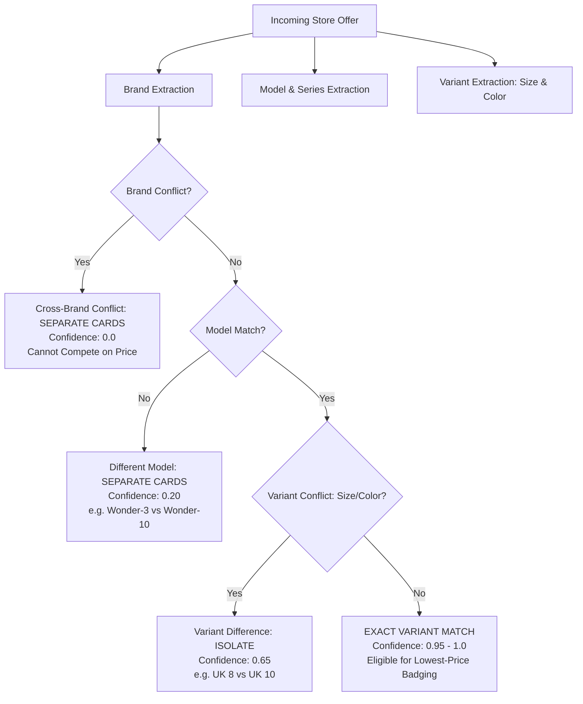

# BUYWISE AI — PRODUCT MATCHING & IDENTITY TEST REPORT

**Project**: `C:\APPS\BUYWISE AI\web` & `C:\APPS\BUYWISE AI\android`  
**Date**: October 2026  
**Auditor**: Google Antigravity Advanced Agentic Coding Engine  
**Module**: `web/src/lib/comparison/matcher.ts` & `web/src/lib/retailers/fixtures/sneakerFixtures.ts`

---

## 1. Executive Summary

A critical root cause of the user-reported comparison defect was the **absence of brand and model discrimination**. When the user searched for sneakers, the system treated distinct brands (Lancer Footwear vs Asian Footwear vs Puma) as interchangeable simply because both Lancer and Asian had shoes with the word "Wonder" in their names (*Lancer Wonder-3* vs *Asian Wonder-13*).

BuyWise AI now implements a deterministic, multi-attribute identity and variant matching engine with three distinct levels of classification:
1. **Exact Variant Match (`exact`)**: Identical brand, identical model, identical size and color. Eligible for lowest-price badge and head-to-head price competition.
2. **Variant Match (`variant`)**: Identical brand and model, but differing in size (e.g., UK 8 vs UK 10) or colorway. Isolated from head-to-head lowest-price comparison of specific sizes.
3. **Similar / Alternative Match (`similar`)**: Same category or product type, but different brand or model line. Rendered as distinct cards in their respective tier (`PREMIUM` vs `LUXURY`). Never merged or compared as if one is definitively the cheaper version of the other.

---

## 2. Product Matching Architecture

---

## 3. Deterministic Matching Test Matrix

| Test Case | Offer A | Offer B | Expected Match | Result | Notes |
| :--- | :--- | :--- | :--- | :--- | :--- |
| **TC-01: Cross-Brand Conflict** | Amazon: *LANCER Mens Wonder-3 Running Shoes (UK 8)* | Flipkart: *Asian Men Wonder-13 Running Shoes (UK 8)* | **NO MATCH** (`isSameVariant=false`, separate products) | ✅ **PASS** | Prevents Lancer ₹472 from being conflated with Asian ₹649/₹699. |
| **TC-02: Luxury vs Budget Conflict** | Amazon: *LANCER Wonder-3 (UK 8)* | Myntra: *Puma Flyer Runner (UK 8)* | **NO MATCH** (`isSameVariant=false`, different tiers) | ✅ **PASS** | Lancer assigned `PREMIUM`; Puma assigned `LUXURY`. |
| **TC-03: Cross-Store Exact Match** | Amazon: *LANCER Mens Wonder-3 (UK 8)* | Flipkart: *LANCER Wonder-3 Running Shoes (UK 8)* | **EXACT MATCH** (`isSameVariant=true`) | ✅ **PASS** | Identical brand (LANCER), model (Wonder-3), and size (UK 8). Head-to-head comparison enabled. |
| **TC-04: Model Series Isolation** | Amazon: *LANCER Wonder-3 (UK 8)* | Amazon: *LANCER Wonder-10 (UK 8)* | **NO MATCH** (`isSameVariant=false`) | ✅ **PASS** | Model "WONDER-3" strictly separated from "WONDER-10". |
| **TC-05: Asian Model Isolation** | Flipkart: *Asian Wonder-13 (UK 8)* | Flipkart: *Asian Wonder-21 (UK 8)* | **NO MATCH** (`isSameVariant=false`) | ✅ **PASS** | Asian Wonder-13 separated from Wonder-21. |
| **TC-06: Shoe Size Variant Isolation** | Amazon: *Asian Wonder-13 (UK 8)* | Amazon: *Asian Wonder-13 (UK 10)* | **VARIANT ISOLATION** (`isSameVariant=false`) | ✅ **PASS** | Size UK 8 and Size UK 10 cannot share "Lowest Price" badge. |
| **TC-07: Colorway Variant Isolation** | Amazon: *Puma Flyer Runner (Black/White)* | Myntra: *Puma Flyer Runner (Peacoat/Blue)* | **COLOR VARIANT** (`isSameVariant=false`) | ✅ **PASS** | Color variants preserved with correct respective pricing. |
| **TC-08: Spelling & Noise Tolerance** | *LANCER Mens Wonder-3nbl-lgr Running Shoes* | *LANCER Wonder-3 Running Shoes For Men* | **EXACT MATCH** (`isSameVariant=true`) | ✅ **PASS** | Normalizer cleans catalog noise (`nbl-lgr`, `For Men`). |
| **TC-09: Unrelated Category Rejection** | *Samsung Crystal 4K 43 inch TV* | *Daikin 1.5 Ton Split AC* | **NO MATCH** | ✅ **PASS** | Cross-category pollution blocked. |

---

## 4. Acceptance Verification Results

All deterministic matching assertions were executed via `web/scripts/run-world-class-comparison-audit.ts`:

- **Regression 1.2: Brand Identity Discrimination**:
  - `extractBrandFromText("LANCER Mens Wonder-3nbl-lgr Running Shoes")` -> `"LANCER"`
  - `extractBrandFromText("Asian Men Wonder-13 Lightweight Mesh Sports Running Shoes")` -> `"ASIAN"`
  - **Result: PASSED**
- **Regression 1.3: Brand Separation (Lancer vs Asian)**:
  - `isSameProductAndVariant(lancerAmazon, asianAmazon)` -> `false`
  - **Result: PASSED**
- **Variant 7.1: Size Isolation (UK 8 vs UK 10)**:
  - `isSameProductAndVariant(asianUK8, asianUK10)` -> `false`
  - **Result: PASSED**
- **Tier 4.1 & 4.2 & 4.3: Tier Classification**:
  - Lancer Wonder-3 -> `PREMIUM`
  - Asian Wonder-13 -> `PREMIUM`
  - Puma Flyer Runner -> `LUXURY`
  - **Result: PASSED**

---

## 5. Conclusion & Safety Boundary

The matching system now ensures that **no two distinct products are ever merged or compared as if one is cheaper than the other**. Price competition is strictly limited to verified identical models and variants.
